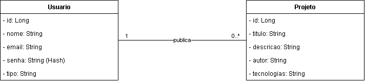

# Documentação de Engenharia de Software - Hub Conecta

Este documento apresenta os artefatos de processo, análise de requisitos, arquitetura e validação aplicados pelo **DevOps Squad** no desenvolvimento da Vitrine de Projetos e Talentos Acadêmicos.

---

## 1. Processo de Desenvolvimento e Metodologia
* **Metodologia Adotada:** Metodologia Ágil baseada no framework **Scrum/Kanban**, utilizando entregas incrementais e iterativas.
* **Práticas Colaborativas:** Divisão de tarefas por backlog funcional, revisão de código entre pares (*Code Review*) e versionamento contínuo no GitHub com commits semânticos (`feat:`, `docs:`, `fix:`, `refactor`).

---

## 2. Elicitação e Análise de Requisitos

### 2.1 Requisitos Funcionais (RF)
* **RF01 - Cadastro de Usuários:** O sistema deve permitir que novos usuários (Estudantes e Mentores) criem uma conta informando nome, e-mail, senha e perfil.
* **RF02 - Autenticação e Redirecionamento por Perfil:** O sistema deve validar as credenciais no servidor e direcionar o usuário para sua respectiva área (`estudante.html`, `mentor.html` ou `administrador.html`).
* **RF03 - Cadastro de Projetos:** O sistema deve permitir que estudantes publiquem seus projetos acadêmicos na vitrine.
* **RF04 - Listagem de Projetos:** O sistema deve exibir dinamicamente os projetos cadastrados no banco de dados para visualização.
* **RF05 - Gestão de Mentorias e Conexões:** O sistema deve possibilitar o acompanhamento de projetos por mentores e a visualização de oportunidades.
* **RF06 - Encerramento de Sessão (Logout):** O sistema deve disponibilizar a função "Sair" para limpar os dados da sessão ativa e encerrar o acesso autenticado.

### 2.2 Requisitos Não Funcionais (RNF)
* **RNF01 - Segurança de Credenciais:** Todas as senhas devem ser criptografadas no servidor utilizando o algoritmo de hash **BCrypt** antes de serem persistidas no banco de dados.
* **RNF02 - Proteção de Contas Administrativas:** O cadastro público de contas com perfil `administrador` deve ser bloqueado tanto na interface quanto na API, exigindo autorização interna.
* **RNF03 - Persistência Relacional:** Os dados devem ser armazenados de forma centralizada em banco de dados **SQLite**, eliminando o armazenamento sensível em navegador (`localStorage`).
* **RNF04 - Arquitetura e Manutenibilidade:** O back-end deve seguir a Arquitetura em Camadas (*Controller*, *Repository*, *Model*) em Java 17 com Spring Boot, aplicando injeção de dependência por construtor.
* **RNF05 - Comunicação Assíncrona:** A interface web deve consumir a API REST utilizando requisições `fetch` com troca de dados em formato JSON.

---

## 3. Padrões de Projeto Aplicados
* **MVC / REST:** Separação clara entre a camada de apresentação (Front-end HTML/CSS/JS) e os controladores de recursos (`ProjetoController`, `UsuarioController`).
* **Repository Pattern:** Abstração da camada de acesso a dados utilizando interfaces do Spring Data JPA (`ProjetoRepository`, `UsuarioRepository`).
* **Dependency Injection (DI):** Uso de injeção via construtor nas classes controladoras para baixo acoplamento e facilidade de manutenção.

---

## 4. Plano de Testes e Validação

### 4.1 Testes de Integração (Front-end + API + SQLite)
| ID | Caso de Teste | Entrada / Ação | Resultado Esperado | Status |
| :--- | :--- | :--- | :--- | :--- |
| **CT01** | Cadastro válido de Estudante | Preencher `cadastro.html` com e-mail inédito e senha | Usuário salvo no SQLite com senha em hash BCrypt; redireciona para login | ✅ Aprovado |
| **CT02** | Bloqueio de e-mail duplicado | Tentar cadastrar um e-mail já existente no banco | API retorna erro `400 Bad Request` e exibe alerta ao usuário | ✅ Aprovado |
| **CT03** | Bloqueio de cadastro de Admin | Tentar enviar perfil `administrador` pelo formulário público | Cadastro bloqueado pelo front-end e barrado pelo `UsuarioController` | ✅ Aprovado |
| **CT04** | Login com sucesso | Inserir e-mail e senha corretos em `login.html` | Senha validada via BCrypt; redireciona para a tela correspondente ao perfil | ✅ Aprovado |
| **CT05** | Login com senha inválida | Inserir e-mail válido e senha incorreta | API retorna `401 Unauthorized` e impede o acesso | ✅ Aprovado |
| **CT06** | Logout real | Clicar no botão "Sair" estando logado | Limpa `sessionStorage` e bloqueia retorno direto às páginas protegidas | ✅ Aprovado |

---

## 5. Modelagem do Sistema (Diagramas UML)

### 5.1 Diagrama de Casos de Uso
O diagrama abaixo ilustra os atores do sistema (*Estudante*, *Mentor* e *Administrador*) e suas respectivas interações com as funcionalidades da plataforma:

### 5.2 Diagrama de Classes
O diagrama abaixo representa a estrutura de orientação a objetos, atributos (incluindo o hash de segurança) e o relacionamento cardinal entre as entidades principais:

