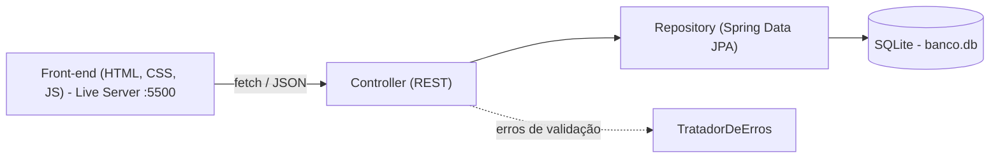
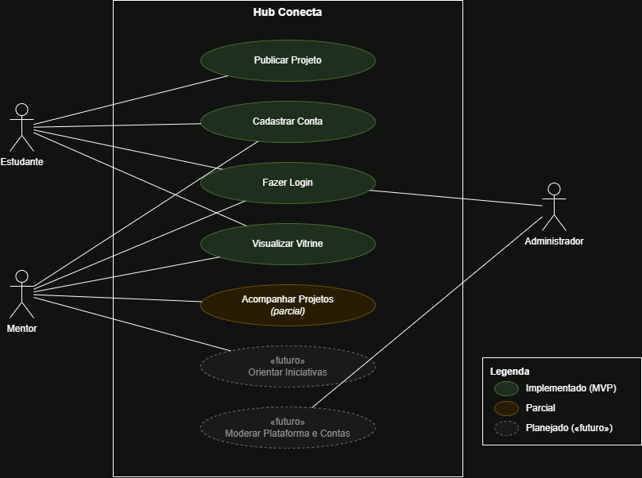

# Documentação de Engenharia de Software - Hub Conecta

Este documento apresenta os artefatos de processo, análise de requisitos, arquitetura, modelagem e validação aplicados pelo **DevOps Squad** no desenvolvimento da Vitrine de Projetos e Talentos Acadêmicos.

> **Legenda de situação:** ✅ Implementado | 🟡 Parcial | ⏳ Previsto (não implementado nesta versão)

---

## 1. Processo de Desenvolvimento e Metodologia

- **Abordagem:** desenvolvimento ágil, com entregas incrementais e iterativas. Cada entrega correspondeu a um marco funcional (cadastro, login, projetos, validações, administrador, documentação).
- **Divisão de responsabilidades:** o trabalho foi dividido por área: HTML, CSS e JavaScript, back-end (API e banco de dados) e documentação.
- **Versionamento:** repositório no GitHub (branch `main`), com commits semânticos (`feat:`, `fix:`, `docs:`, `refactor:`, `style:`, `chore:`).
- **Organização do repositório:** o `.gitignore` na raiz impede o envio de arquivos gerados (`target/`, logs, banco local e arquivos da IDE).

---

## 2. Elicitação e Análise de Requisitos

### 2.1 Requisitos Funcionais (RF)

| ID | Requisito | Situação | Observação |
|---|---|---|---|
| **RF01** | **Cadastro de usuários:** permitir que Estudantes e Mentores criem uma conta informando nome, e-mail, senha e perfil. | ✅ | Perfis aceitos no cadastro público: `estudante` e `mentor`. |
| **RF02** | **Autenticação e redirecionamento por perfil:** validar as credenciais no servidor e direcionar o usuário para `estudante.html`, `mentor.html` ou `administrador.html`. | ✅ | Senha conferida com BCrypt no servidor. |
| **RF03** | **Cadastro de projetos:** permitir que estudantes publiquem seus projetos na vitrine. | ✅ | Campos: título, descrição, área; autor obtido da sessão. |
| **RF04** | **Listagem de projetos:** exibir dinamicamente os projetos do banco de dados. | ✅ | Vitrine geral e "Meus projetos" (filtro por e-mail do autor). |
| **RF05** | **Gestão de mentorias e conexões:** possibilitar o acompanhamento de projetos por mentores e a visualização de oportunidades. | 🟡 / ⏳ | O mentor visualiza a vitrine (acompanhamento parcial). Mentorias, conexões e oportunidades reais estão previstas; os cards atuais são ilustrativos. |
| **RF06** | **Encerramento de sessão (logout):** disponibilizar a função "Sair" para limpar a sessão ativa. | ✅ | Limpa o `sessionStorage` do navegador. |
| **RF07** | **Provisionamento do administrador:** garantir uma conta de administrador sem permitir seu cadastro público. | ✅ | Criada automaticamente ao subir o back-end, com senha vinda da variável de ambiente `ADMIN_SENHA`. *(Incluído durante a implementação.)* |

### 2.2 Requisitos Não Funcionais (RNF)

| ID | Requisito | Situação | Como foi atendido |
|---|---|---|---|
| **RNF01** | **Segurança de credenciais:** senhas criptografadas no servidor com hash BCrypt antes de persistir. | ✅ | `BCryptPasswordEncoder` (módulo `spring-security-crypto`). A resposta da API nunca devolve a senha. |
| **RNF02** | **Proteção de contas administrativas:** bloquear o cadastro público de `administrador`, na interface e na API. | ✅ | O formulário só oferece Estudante e Mentor; o `UsuarioController` recusa com HTTP 400 qualquer outro perfil. |
| **RNF03** | **Persistência relacional:** dados em banco **SQLite** centralizado, sem armazenar dados de negócio no navegador. | ✅ | Usuários e projetos ficam no SQLite. No navegador, o `sessionStorage` guarda apenas a sessão (nome, e-mail e perfil), **nunca a senha**. |
| **RNF04** | **Arquitetura e manutenibilidade:** back-end em camadas (*Controller*, *Repository*, *Model*), Java 17 e Spring Boot, com injeção de dependência por construtor. | ✅ | Também há os pacotes `config` (inicialização do administrador) e `exception` (tratamento de erros). |
| **RNF05** | **Comunicação assíncrona:** a interface consome a API REST com `fetch` e JSON. | ✅ | `app.js` conversa com `/api/usuarios` e `/api/projetos`. |
| **RNF06** | **Validação de dados no servidor:** rejeitar dados inválidos com mensagens claras. | ✅ | Bean Validation (`@NotBlank`, `@Email`, `@Size`, `@Valid`) e `TratadorDeErros`, que responde HTTP 400. *(Incluído durante a implementação.)* |
| **RNF07** | **Interface responsiva e acessível:** layout adaptável e navegação por teclado. | ✅ | CSS com variáveis, grades responsivas, foco visível e contraste revisado. *(Incluído durante a implementação.)* |

---

## 3. Arquitetura e Padrões de Projeto

### 3.1 Arquitetura

A aplicação é dividida em duas partes que se comunicam por HTTP com troca de dados em JSON:

| Camada | Pacote / arquivo | Responsabilidade |
|---|---|---|
| Apresentação | `frontend/` | Páginas, estilos e consumo da API |
| Controller | `controller/` | Recebe as requisições HTTP, aplica as regras e responde |
| Model | `model/` | Entidades JPA (`Usuario`, `Projeto`) e regras de validação dos campos |
| Repository | `repository/` | Acesso ao banco, sem escrever SQL |
| Configuração | `config/` | Criação do administrador ao iniciar |
| Exceções | `exception/` | Transforma erros de validação em respostas HTTP 400 |

### 3.2 Padrões e boas práticas aplicados

- **MVC / REST:** separação entre a interface (front-end) e os controladores de recursos (`ProjetoController`, `UsuarioController`), expostos como rotas REST.
- **Repository Pattern:** acesso a dados abstraído por interfaces do Spring Data JPA (`ProjetoRepository`, `UsuarioRepository`), com consultas derivadas do nome do método (`findByEmail`, `findByAutorEmail`).
- **Injeção de dependência por construtor:** os controladores recebem os repositórios pelo construtor, com baixo acoplamento.
- **Tratamento centralizado de erros:** `@RestControllerAdvice` (`TratadorDeErros`) concentra a resposta aos erros de validação.
- **Validação declarativa:** regras escritas como anotações nas entidades e ativadas com `@Valid` nos controladores.
- **Inicialização de dados (seed):** `CommandLineRunner` cria o administrador apenas se ele ainda não existir (idempotente).
- **Configuração externalizada:** dados sensíveis (senha do administrador) vêm de variável de ambiente, não do código.

---

## 4. Modelagem do Sistema (Diagramas UML)

### 4.1 Diagrama de Casos de Uso

O diagrama ilustra os atores do sistema (*Estudante*, *Mentor* e *Administrador*) e suas interações com a plataforma.

**Situação de cada caso de uso nesta versão:**

| Ator | Caso de uso | Situação | Observação |
|---|---|---|---|
| Estudante | Cadastrar Conta | ✅ | `cadastro.html` e `POST /api/usuarios/cadastrar` |
| Estudante | Fazer Login | ✅ | `login.html` e `POST /api/usuarios/login` |
| Estudante | Publicar Projeto | ✅ | Formulário em `estudante.html` e `POST /api/projetos` |
| Estudante | Visualizar Vitrine | ✅ | Vitrine geral e "Meus projetos" |
| Mentor | Fazer Login | ✅ | Redirecionado para `mentor.html` |
| Mentor | Acompanhar Projetos | 🟡 | Visualiza a vitrine (somente leitura); sem filtros nem acompanhamento individual |
| Mentor | Orientar Iniciativas | ⏳ | Previsto (feedbacks e mentorias) |
| Administrador | Acesso Restrito | ✅ | Conta criada pelo sistema; acessa `administrador.html` |
| Administrador | Moderar Plataforma e Contas | ⏳ | Previsto (exclusão de projetos e gestão de usuários); hoje visualiza a vitrine |

### 4.2 Diagrama de Classes

O diagrama representa as entidades principais e seus atributos (incluindo a senha armazenada como hash).

**Atributos das entidades, conforme implementadas no código:**

| Classe | Atributo | Tipo | Observação |
|---|---|---|---|
| `Usuario` | `id` | `Long` | Chave primária, gerada automaticamente |
| | `nome` | `String` | Obrigatório |
| | `email` | `String` | Obrigatório, formato válido e **único** |
| | `senha` | `String` | Obrigatória, 6 a 72 caracteres; armazenada como **hash BCrypt** |
| | `tipo` | `String` | `estudante`, `mentor` ou `administrador` |
| `Projeto` | `id` | `Long` | Chave primária, gerada automaticamente |
| | `title` | `String` | Obrigatório, até 150 caracteres |
| | `description` | `String` | Obrigatória, até 1000 caracteres |
| | `area` | `String` | Obrigatória (ex.: Tecnologia, Saúde, Educação) |
| | `autor` | `String` | Nome do estudante, exibido na vitrine |
| | `autorEmail` | `String` | E-mail do estudante autor, usado no filtro "Meus projetos" |

**Relacionamento:** um `Usuario` publica zero ou mais `Projeto` (1 para 0..\*). Na implementação, o vínculo é **lógico**: o `Projeto` guarda o `autorEmail`, que corresponde ao `email` único do `Usuario`. Não há `@ManyToOne` nem chave estrangeira no banco. A evolução prevista é transformar esse vínculo em relacionamento JPA com chave estrangeira (ver seção 7).

### 4.3 Modelo de Dados (SQLite)

O Hibernate cria as tabelas automaticamente na primeira execução (`spring.jpa.hibernate.ddl-auto=update`).

**Tabela `usuarios`**

| Coluna | Tipo | Restrições |
|---|---|---|
| `id` | INTEGER | PK, autoincremento |
| `nome` | VARCHAR | - |
| `email` | VARCHAR | ÚNICO |
| `senha` | VARCHAR | hash BCrypt (60 caracteres) |
| `tipo` | VARCHAR | - |

**Tabela `projetos`**

| Coluna | Tipo | Restrições |
|---|---|---|
| `id` | INTEGER | PK, autoincremento |
| `title` | VARCHAR | NOT NULL |
| `description` | VARCHAR | NOT NULL |
| `area` | VARCHAR | NOT NULL |
| `autor` | VARCHAR | NOT NULL |
| `autor_email` | VARCHAR | NOT NULL |

---

## 5. Plano de Testes e Validação

Os testes foram **manuais e funcionais**: pela interface, por requisições `fetch` no Console do navegador, pela inspeção da aba *Network* (status HTTP e CORS) e por um teste de **clone limpo** do repositório seguindo apenas o README. Não há testes automatizados nesta versão.

O registro completo (35 casos, com passos, resultado esperado e status) está em **[Testes.md](Testes.md)**.

| Área | Casos | Aprovados |
|---|---|---|
| Infraestrutura e integração | 4 | 4 |
| Cadastro | 10 | 10 |
| Autenticação e controle de acesso | 9 | 9 |
| Projetos | 7 | 7 |
| Interface, documentação e entrega | 5 | 5 |
| **Total** | **35** | **35** |

---

## 6. Versionamento e Documentação

- **Git/GitHub:** branch `main`, commits semânticos e `.gitignore` na raiz (`target/`, `.vscode/`, `*.log`, `*.db`).
- **README.md:** como clonar, configurar e executar, rotas da API, perfis, estrutura de pastas e limitações conhecidas.
- **Testes.md:** plano e registro dos casos de teste.
- **Este documento:** requisitos, arquitetura, padrões e modelagem.

---

## 7. Limitações Conhecidas e Evolução

| Limitação | Evolução prevista |
|---|---|
| Proteção das telas feita apenas em JavaScript (`sessionStorage`) | Autenticação com JWT e verificação do perfil no back-end |
| `POST /api/projetos` não verifica quem faz a requisição; `autor` e `autorEmail` vêm do front-end | Definir o autor a partir do usuário autenticado |
| Vínculo entre `Usuario` e `Projeto` apenas lógico (`autorEmail`) | `@ManyToOne` com chave estrangeira |
| Entidades usadas diretamente como corpo das requisições | Objetos de transferência (DTO) |
| Perfil (`tipo`) como texto livre | Enumeração (`enum`) |
| Mentorias, conexões, oportunidades e perfil Empresa não implementados | Novos módulos e telas |
| Administrador apenas visualiza a vitrine | Moderação: excluir projetos e gerenciar usuários |
| Testes somente manuais | JUnit, Mockito, `MockMvc` e testes ponta a ponta |
| Tabelas criadas por `ddl-auto=update` | Migrações versionadas (Flyway ou Liquibase) |